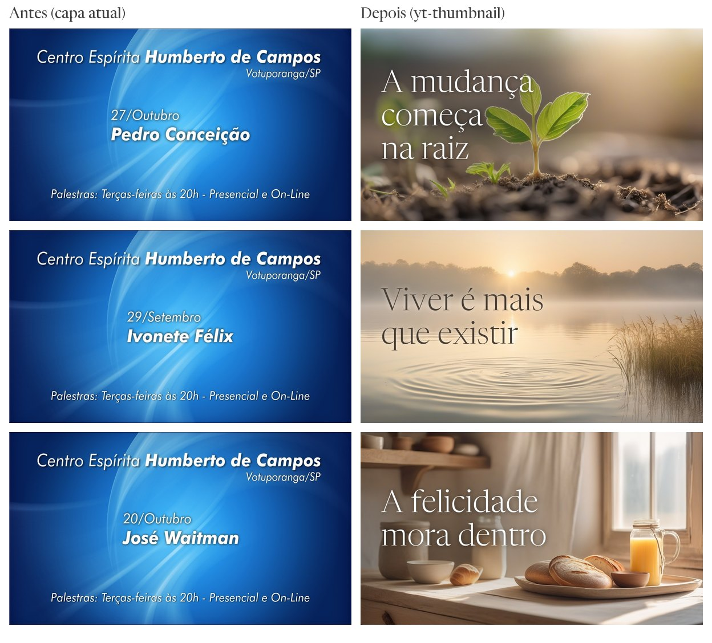

# yt-thumbnail

Gerador automático de capas (thumbnails) para playlists do YouTube, rodando **localmente** num PC Windows com GPU NVIDIA.



Para cada vídeo (longo ou Short) de uma playlist pública dos seus canais, o yt-thumbnail:

1. obtém a transcrição (legenda do YouTube ou `faster-whisper` na GPU);
2. analisa o conteúdo com o Claude Code e escreve um prompt de imagem e um título curto, seguindo um **preset** de identidade visual;
3. gera a imagem com **SDXL 1.0**, local e sem texto;
4. escreve o título com Pillow, conferindo contraste e legibilidade em miniatura;
5. monta uma página HTML para **revisão humana**, com a capa atual ao lado de 3 variações;
6. envia só as capas que você aprovou, pela YouTube Data API e no canal certo, guardando a capa original para poder voltar atrás.

Shorts ganham capa vertical, com o título no quadrado central:


> **Versão 0.1.0.** Veja o [CHANGELOG](CHANGELOG.md) e o [plano](PLANO.md).

## Requisitos

| | Mínimo | Testado |
|---|---|---|
| Sistema | Windows 10/11 (Linux deve funcionar, sem testes) | Windows 10 Pro |
| GPU | NVIDIA com 8 GB de VRAM | RTX 3060 Ti 8 GB |
| RAM | 8 GB (com `imagem.cpu_offload: true`) | 8 GB; 16 GB ou mais é mais confortável |
| Disco | ~15 GB para os modelos, baixados do Hugging Face na primeira execução | |
| Programas | Python 3.11–3.13, Git, [FFmpeg](https://ffmpeg.org/), [Claude Code](https://claude.com/claude-code) | Python 3.12 |
| Conta | Projeto no Google Cloud com a YouTube Data API ativada (gratuito) | |

Tempos medidos com uma RTX 3060 Ti: ~75 s por imagem no SDXL e cerca de 30 minutos para levar 4 vídeos da playlist até a revisão. Com duas GPUs, a imagem cai para ~52 s (`gpu.texto_sdxl` na segunda placa).

## Início rápido

1. **Instale** Python, Git, FFmpeg, driver NVIDIA e Claude Code, e depois o projeto. O passo a passo completo está em [docs/instalacao-windows.md](docs/instalacao-windows.md):
   ```powershell
   git clone https://github.com/macckk/yt-thumbnail.git
   cd yt-thumbnail
   py -3.12 -m venv .venv
   .\.venv\Scripts\Activate.ps1
   pip install torch --index-url https://download.pytorch.org/whl/cu128
   pip install -e ".[gpu]"
   pip install nvidia-cublas-cu12 "nvidia-cudnn-cu12==9.*"
   python scripts/baixar_fontes.py
   yt-thumbnail ambiente
   ```
2. **Configure** a playlist e o canal: `copy config.example.yaml config.yaml` e edite. Veja [docs/configuracao.md](docs/configuracao.md); para conferir, use `yt-thumbnail validar`.
3. **Crie o seu OAuth client** no Google Cloud, salve-o em `secrets/client_secret.json` e entre no canal com `yt-thumbnail auth --canal <apelido>`. O passo a passo está em [docs/google-oauth.md](docs/google-oauth.md).
4. **Gere as capas**: `yt-thumbnail tudo --limite 2` roda da playlist até a revisão; depois abra `saida\<job>\revisao.html` no navegador (ou use `--abrir`).
5. **Aprove e envie**: `yt-thumbnail aprovar <id> --variacao 2`, depois `yt-thumbnail enviar --aprovados --dry-run` e, se estiver tudo certo, `yt-thumbnail enviar --aprovados`.

## Fluxo do dia a dia

```powershell
yt-thumbnail tudo                               # da playlist até a revisão (só o que falta)
# abra saida\<job>\revisao.html e escolha as capas:
yt-thumbnail aprovar <id> --variacao 2          # ou: aprovar --todos --variacao 1
yt-thumbnail enviar --aprovados --dry-run       # confira
yt-thumbnail enviar --aprovados                 # envia ao YouTube
```

Se algo der errado, `yt-thumbnail restaurar <id>` volta a capa original. Detalhes em [docs/uso-cli.md](docs/uso-cli.md).

## Limitações conhecidas

- **Login de 7 dias:** com o app do Google Cloud em modo **Teste**, o login vence em 7 dias e é preciso rodar `yt-thumbnail auth` de novo. Publicar o app evita isso; veja [docs/google-oauth.md](docs/google-oauth.md).
- **Cota da API:** cada capa enviada custa ~50 unidades de uma cota de 10.000 por dia, o que dá ~200 capas por dia. Quando a cota acaba, o lote para e continua no dia seguinte.
- **Shorts:** a capa é enviada quando o canal permite trocar a capa de Shorts. Se a API recusar (403), o vídeo fica como "não elegível", sem erro. Veja [docs/shorts.md](docs/shorts.md).
- **Legendas do YouTube:** o YouTube às vezes bloqueia o download das legendas (HTTP 429). Nesses casos, a transcrição é feita pelo Whisper, o que é mais lento.
- **Texto na imagem:** o SDXL não escreve o título; quem escreve é o Pillow. No Windows, sem `libraqm`, fontes com acentos combinados podem sair deslocadas, por isso o preset usa Newsreader.
- **Análise com Claude Code:** a análise usa o `claude -p` (assinatura do Claude). Por SSH, é preciso um token de longa duração; veja [docs/solucao-de-problemas.md](docs/solucao-de-problemas.md).

## Importante

- **Cada pessoa cria o seu próprio OAuth client** no Google Cloud. O projeto não distribui credenciais.
- **Os modelos não são distribuídos** neste repositório. Eles são baixados do Hugging Face na primeira execução, sob as licenças deles (ver [THIRD_PARTY_NOTICES.md](THIRD_PARTY_NOTICES.md)).
- `config.yaml`, `secrets/` e `saida/` ficam fora do git. Veja [SECURITY.md](SECURITY.md).
- Nada é enviado ao YouTube sem a sua aprovação explícita, vídeo por vídeo ou com `aprovar --todos`.

## Documentação

| Documento | Conteúdo |
|---|---|
| [Instalação no Windows](docs/instalacao-windows.md) | do zero até `yt-thumbnail ambiente` OK |
| [Configuração](docs/configuracao.md) | referência do `config.yaml` |
| [Google Cloud e login](docs/google-oauth.md) | OAuth client, login por canal, cota |
| [Uso da CLI](docs/uso-cli.md) | comandos e opções |
| [Presets](docs/presets.md) | identidade visual e como criar novos |
| [Shorts](docs/shorts.md) | capas verticais e envio |
| [Arquitetura](docs/arquitetura.md) | fluxo, estados e arquivos |
| [Solução de problemas](docs/solucao-de-problemas.md) | erros comuns |

Quer contribuir? Veja [CONTRIBUTING.md](CONTRIBUTING.md).

## Licença

Copyright (C) 2026 macckk.

Este programa é software livre: você pode redistribuí-lo e/ou modificá-lo sob os termos da **GNU General Public License v3.0 ou posterior** (`GPL-3.0-or-later`). Veja [LICENSE](LICENSE). Componentes de terceiros (modelos, fontes e bibliotecas) têm licenças próprias, listadas em [THIRD_PARTY_NOTICES.md](THIRD_PARTY_NOTICES.md).
